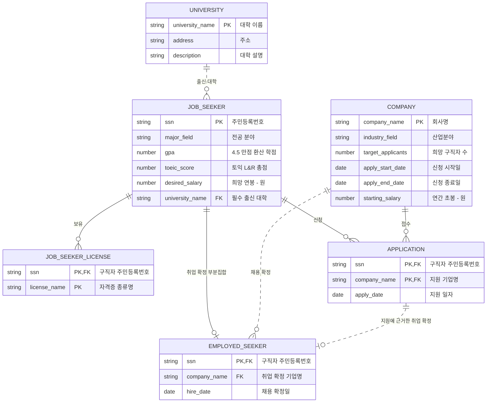
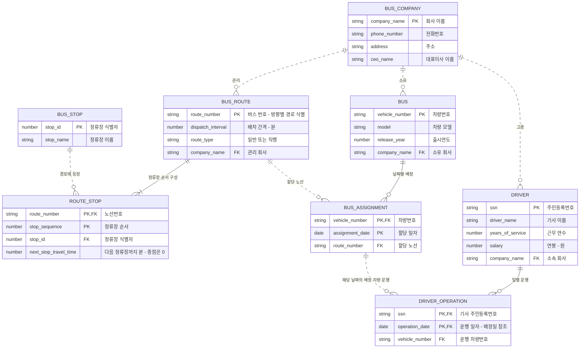

# 데이터베이스 설계

## 문제 1의 DB

### 1. 개념적 설계

- 기업은 회사명, 구직자는 주민등록번호로 식별한다. 대학은 대학명으로 식별한다고 가정한다.
- 대학과 구직자는 1:N 관계이다. 구직자는 정확히 하나의 출신 대학을 가진다.
- 구직자와 기업의 취업 신청은 N:M 관계이며, 신청 일자를 관계 속성으로 관리한다.
- 취업 확정자는 구직자의 부분집합이다. 구직자는 취업이 확정되지 않았거나 하나의 기업에 취업이 확정된 상태이다.
- 구직자의 자격증은 다중값 속성이다. 대학별·기업별 취업자 수는 취업 확정 정보에서 계산되는 파생 정보이다.

### 2. 합리적 가정 및 논리적 설계 기준

1. 구직자는 하나의 출신 대학을 반드시 등록한다. 복수 학위 및 대학 미상인 경우는 범위에서 제외한다. 대학명은 중복되지 않는다고 가정한다.
2. 기업의 신청 기간은 시작일과 종료일로 구분한다. 기간 미등록 시 두 값 모두 NULL이며, 등록 시 시작일은 종료일보다 늦을 수 없다. 기업별 모집 차수와 반복 지원 이력은 관리하지 않는다.
3. 구직자는 기업별로 한 번만 지원한다. 지원하지 않은 구직자와 지원자를 받지 않은 기업도 등록할 수 있다. N:M 관계는 APPLICATION으로 변환하고 (ssn, company_name)을 복합 기본키로 사용한다.
4. 취업 확정자는 기존 지원 내역에 근거하여 등록한다. EMPLOYED_SEEKER의 (ssn, company_name)은 APPLICATION의 복합 기본키를 참조한다. 한 구직자의 현재 취업 확정 기업은 최대 하나이며 과거 이직 이력은 관리하지 않는다. 취업 확정 후에도 JOB_SEEKER 행을 유지한다.
5. 자격증 목록을 한 칸에 저장하지 않는다. JOB_SEEKER_LICENSE에 구직자별 자격증 한 종류를 한 행으로 저장하며 (ssn, license_name)을 기본키로 사용한다. 자격증 명칭은 종류를 구분할 수 있게 표준화하며, 자격증별 발급기관·취득일·갱신 이력은 관리하지 않는다. 자격증이 없는 구직자는 해당 테이블에 행이 없다.
6. 학점은 4.5 만점으로 환산한 값, 토익은 L&R 총점(10~990점, 5점 단위)으로 가정한다. 미등록·미응시 점수는 NULL로 표현한다. 금액은 원 단위이며 초봉은 연간 초봉으로 가정한다. 인원과 금액은 음수가 될 수 없다.
7. 대학별로 각 기업에 취업한 학생 수를 관리한다. 중복 저장에 따른 불일치를 막기 위해 기존 UNIVERSITY_EMPLOYMENT_STAT 집계 테이블을 같은 이름의 일반 뷰로 변경한다. 구직자의 출신 대학과 현재 취업 확정 기업을 기준으로 계산하며, 취업자가 없는 대학-기업 조합도 0으로 조회된다. 대학별 전체 취업자 수도 원자료를 집계하여 계산할 수 있다.
8. 통계는 별도 저장되는 독립 엔티티가 아니라 파생 정보이므로 아래 테이블 ER 다이어그램에는 포함하지 않는다. 뷰 스키마는 UNIVERSITY_EMPLOYMENT_STAT(university_name, company_name, employed_count)이며 실제 PK/FK 제약조건은 없다.
9. 식별자, 관계를 성립시키는 외래키, 지원일·채용 확정일은 필수이다. 나머지 일반 속성은 별도 NOT NULL 명시가 없으면 미등록 상태를 허용한다. 참조 중인 부모 데이터의 삭제는 제한하여 지원·취업 기록의 연쇄 삭제를 방지한다.

### 3. ER 다이어그램 및 관계형 모델

아래 다이어그램은 개념적 관계를 테이블로 변환한 논리 ERD이다. PK는 기본키, FK는 외래키이다. 실선은 식별 관계, 점선은 비식별 관계를 표현한다.

EMPLOYED_SEEKER의 ssn과 company_name은 함께 APPLICATION을 참조한다. APPLICATION의 전체 복합키가 EMPLOYED_SEEKER의 기본키에 포함되는 것은 아니므로 두 테이블의 관계는 비식별 관계로 표현했다. 한 구직자의 취업 확정 행은 ssn 기본키에 의해 최대 하나로 제한된다.

---

## 문제 2의 DB

### 1. 개념적 설계

- 버스 회사는 여러 노선·차량·기사를 관리한다. 각 노선·차량·기사는 각각 하나의 관리·소유·소속 회사를 가진다.
- 노선과 정류장은 N:M 관계이다. 같은 정류장을 재방문할 수 있으므로 노선 내 정류장의 출현 순서를 구분한다.
- 차량은 날짜별로 노선에 배정된다. 한 차량은 서로 다른 날짜에 서로 다른 노선에 배정될 수 있다.
- 기사의 날짜별 운행은 해당 날짜의 차량 배정에 연결한다. 운행 노선은 차량 배정으로 결정된다.

### 2. 합리적 가정 및 논리적 설계 기준

1. 회사명은 버스 회사를, 차량번호는 차량을, 주민등록번호는 기사를 식별한다. 정류장 이름은 중복 가능하므로 별도의 stop_id를 부여한다. 기사 이름은 식별용이 아닌 추가 관리 속성이다.
2. 노선번호는 하나의 순서 있는 경로를 식별한다. 상·하행 경로를 별도로 관리할 경우 방향을 포함한 서로 다른 노선번호를 부여한다. 노선 유형은 일반 또는 직행이다.
3. ROUTE_STOP의 기본키는 (route_number, stop_sequence)이다. 순서는 1부터 연속하는 정수이며 한 노선에는 출발지와 종점을 포함한 최소 2개의 정류장 출현이 있다. 출발지는 순서 1, 종점은 최대 순서의 정류장으로 결정하므로 별도 중복 속성으로 저장하지 않는다.
4. 동일한 정류장을 한 노선에서 여러 번 지나는 순환 경로를 허용한다. 따라서 (route_number, stop_id)에는 UNIQUE 제약조건을 추가하지 않는다.
5. next_stop_travel_time은 해당 순서의 정류장에서 다음 순서의 정류장까지 걸리는 시간을 분 단위로 기록한다. 소수 둘째 자리까지 저장하며 종점의 값은 0, 나머지는 양수이다. 전체 소요 시간은 해당 노선의 이 값을 합산한 구간 이동 시간이며, 별도의 정차·대기 시간은 관리하지 않는다.
6. 정류장 최소 개수, 순서의 연속성, 종점만 소요 시간 0인 규칙은 여러 행을 비교해야 한다. 제출 DDL의 일반 CHECK/FK만으로는 이를 모두 강제하지 않으므로 노선 등록·수정 트랜잭션에서 검증하는 업무 규칙으로 명시한다. DDL은 순서의 양수 여부와 소요 시간의 비음수 여부를 강제한다.
7. 한 차량은 하루에 최대 한 노선에 배정된다. BUS_ASSIGNMENT의 기본키는 (vehicle_number, assignment_date)이다. 배정되지 않은 날짜는 행이 없다.
8. 한 기사는 하루에 최대 한 차량을 운행한다고 가정한다. DRIVER_OPERATION의 기본키는 (ssn, operation_date)이다. 한 차량의 같은 날짜 배정에 여러 기사가 연결되는 교대 운행은 허용하되, 교대 시간과 개별 운행 회차는 관리하지 않는다.
9. DRIVER_OPERATION의 (vehicle_number, operation_date)는 BUS_ASSIGNMENT의 (vehicle_number, assignment_date)를 참조한다. 이 관계로 그날 배정되지 않은 차량의 운행 기록을 방지한다. 운행 노선은 BUS_ASSIGNMENT에서 조회하므로 DRIVER_OPERATION에 route_number를 중복 저장하지 않는다.
10. Oracle DATE는 시간까지 포함하므로 배정일·운행일은 시각 없는 날짜(00:00:00)로 저장한다. DDL의 CHECK 제약조건으로 이 규칙을 강제하여 같은 날짜에 시각만 다른 중복 행을 방지한다.
11. 차량 소유 회사, 노선 관리 회사, 기사 소속 회사가 반드시 같아야 한다는 조건은 요구사항에 없다. 본 설계는 회사 간 차량 지원·기사 파견을 허용하는 것으로 가정하고 세 회사의 일치를 강제하지 않는다.
12. 배차 간격은 양의 정수(분), 근무 연수는 완료한 근무 연수(0 이상의 정수), 연봉은 원 단위의 비음수 값이다. 출시연도는 네 자리 연도이다. 회사·차량·기사는 현재 정보만 관리하고 소속 변경 이력은 범위에서 제외한다.
13. 필수 관계의 외래키와 운행 관리에 필요한 날짜·정류장 순서·구간 시간·배차 간격·노선 유형은 NOT NULL이다. 그 밖의 일반 속성은 DDL에 별도 NOT NULL이 없으면 미등록을 허용한다. 참조 중인 부모 데이터 삭제는 제한한다.

### 3. ER 다이어그램 및 관계형 모델

- Mermaid의 1개 이상 표기로는 최소 2개를 정확하게 표현할 수 없으므로, 노선별 정류장 최소 2개 조건은 위 업무 규칙으로 보완한다. 완성된 노선은 이 조건을 만족해야 하며, 노선 생성과 정류장 등록은 같은 업무 트랜잭션에서 처리한다.
- DRIVER_OPERATION의 operation_date와 vehicle_number는 함께 BUS_ASSIGNMENT를 참조하는 하나의 복합 외래키를 구성한다.
- 자료형의 길이·정밀도, NOT NULL, CHECK, 복합 외래키 등 상세 물리 제약조건은 함께 제출하는 ddl.txt에 정의한다.
