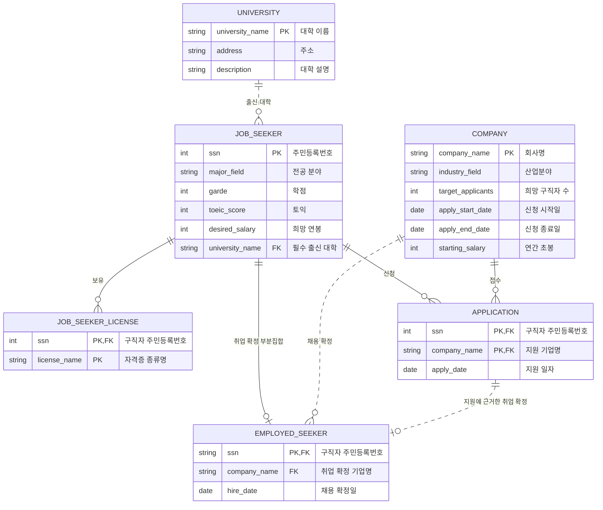
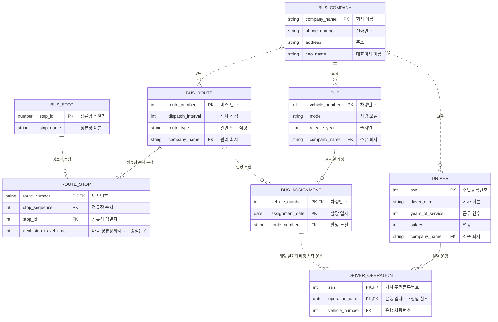

## 문제 1의 DB

### 가정 사항
1. 대학 이름은 중복되지 않으며, 구직자는 하나의 출신 대학을 반드시 가진다고 가정한다. 복수 학위와 출신 대학이 확인되지 않은 경우는 관리 범위에서 제외한다.
2. 기업별 모집 차수는 구분하지 않으며, 구직자는 동일한 기업에 한 번만 지원할 수 있다고 가정한다. 아직 지원하지 않은 구직자와 지원자를 받지 않은 기업도 등록할 수 있다.
3. 기업의 신청 기간은 시작일과 종료일로 관리한다. 기간을 등록하지 않은 경우에는 두 날짜를 모두 비워두며, 등록하는 경우 시작일은 종료일보다 늦을 수 없다.
4. 취업 확정은 기존 지원 내역을 근거로 이루어진다고 가정한다. 한 구직자의 현재 취업 확정 기업은 최대 하나이며, 과거 이직 이력은 관리하지 않는다. 취업이 확정된 후에도 기존 구직자 정보는 유지한다.
5. 구직자는 자격증을 보유하지 않거나 여러 종류를 보유할 수 있다. 자격증 명칭은 종류를 구분할 수 있도록 표준화하며, 동일한 자격증 종류는 중복 등록하지 않는다. 발급기관, 취득일 및 갱신 이력은 관리하지 않는다.
6. 대학 학점은 4.5 만점으로 환산한 값으로 관리한다. 토익 성적은 10점부터 990점까지 저장한다. 미등록 학점과 미응시·미등록 토익 성적은 NULL로 표시한다.
7. 초봉과 희망 연봉의 단위는 원이며, 초봉은 연간 금액으로 가정한다. 희망 구직자 수와 금액은 음수가 될 수 없다.
8. 취업 학생 수는 현재 등록된 취업 확정자를 기준으로 대학별·기업별로 집계하며, 과거 누적 취업자 수는 관리하지 않는다. 취업자가 없는 대학과 기업의 조합은 0명으로 표시한다.
9. 지원 일자와 채용 확정일을 추가로 관리하며, 별도로 입력하지 않으면 등록 시점을 기본값으로 사용한다.
10. 식별자, 출신 대학, 지원·취업 대상 기업, 지원 일자 및 채용 확정일은 필수 정보로 관리한다. 그 밖의 일반 속성은 미등록 상태를 허용한다. 다른 기록에서 참조 중인 정보는 삭제할 수 없다고 가정한다.

## 문제 2의 DB

### 가정 사항
1. 버스 회사 이름과 차량번호는 각각 중복되지 않는다고 가정한다. 정류장 이름은 중복될 수 있으므로 정류장마다 별도의 식별번호를 부여한다. 기사의 이름은 추가 관리 정보로 저장한다.
2. 각 노선번호는 하나의 순서 있는 경로를 나타낸다고 가정한다. 상행과 하행을 별도로 관리하는 경우에는 방향을 포함한 서로 다른 노선번호를 부여한다.
3. 정류장 순서는 1부터 시작하는 연속된 정수로 관리한다. 한 노선에는 출발지와 종점을 포함하여 최소 두 개의 정류장 출현이 있으며, 첫 번째 순서를 출발지, 마지막 순서를 종점으로 본다.
4. 순환 노선을 표현할 수 있도록 동일한 정류장을 한 노선에서 여러 번 지나는 것을 허용한다.
5. 인접한 정류장 사이의 소요 시간은 분 단위로 소수 둘째 자리까지 저장한다. 종점의 다음 정류장까지 소요 시간은 0으로 기록하고, 나머지 구간은 양수로 기록한다. 전체 소요 시간에는 구간 이동 시간만 포함하며 별도의 정차·대기 시간은 관리하지 않는다.
6. 한 차량은 하루에 최대 하나의 노선에 배정된다고 가정한다. 배정되지 않은 날짜에는 배정 기록을 저장하지 않는다.
7. 한 기사는 하루에 최대 한 차량을 운행한다고 가정한다. 같은 날짜에 여러 기사가 한 차량을 교대로 운행하는 것은 허용하지만, 교대 시간과 개별 운행 회차는 관리하지 않는다.
8. 기사의 운행 기록은 해당 날짜에 노선이 배정된 차량에 대해서만 등록할 수 있으며, 운행 노선은 그날 차량에 배정된 노선과 같다고 가정한다.
9. 차량 배정과 기사 운행은 일 단위로 관리하며, 배정일과 운행일의 시간 부분은 00:00:00으로 통일한다.
10. 회사 간 차량 지원과 기사 파견을 허용한다고 가정한다. 따라서 차량 소유 회사, 노선 관리 회사 및 기사 소속 회사가 반드시 같을 필요는 없다.
11. 배차 간격은 분 단위의 양의 정수, 근무 연수는 완료한 근무 연수를 나타내는 0 이상의 정수로 관리한다. 출시연도는 네 자리 연도로 저장한다.
12. 회사·차량·기사의 정보는 현재 상태를 기준으로 관리하며, 회사 소속 및 차량 소유 관계의 변경 이력은 관리하지 않는다.
13. 식별자와 소속·배정 관계에 필요한 정보, 기사 이름, 정류장 이름, 날짜, 정류장 순서, 구간 소요 시간, 배차 간격 및 노선 유형은 필수로 관리한다. 그 밖의 일반 속성은 미등록 상태를 허용한다. 다른 기록에서 참조 중인 정보는 삭제할 수 없다고 가정한다.

